# Dev Life · 克码人生

[Back to home](../README.md) · English | [简体中文](README.zh-CN.md)

| # | Name | Sticker | Story |
|---|---|---|---|
| 1 | **hello, world** | 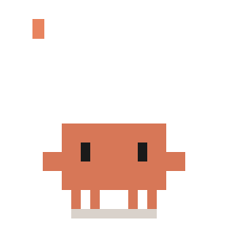 | Types `hello, world` and waves. Good for saying hi. |
| 2 | **Thinking** | 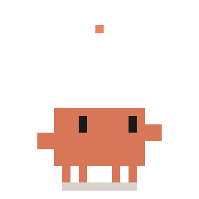 | Claude Code's ✻ spinner turns above its head while dots appear one by one and it tilts its head, deep in thought. |
| 3 | **ultrathink** |  | `ultrathink` appears in rainbow letters. It thinks so hard it turns red and steams, then a light bulb goes on. |
| 4 | **Plan Mode** | 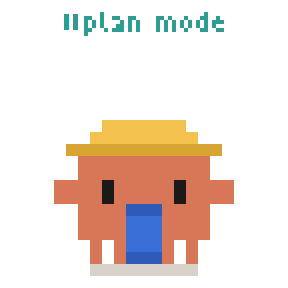 | Puts on a hard hat, unrolls a blueprint and sketches a little house on it before writing any code. |
| 5 | **Todo List** | 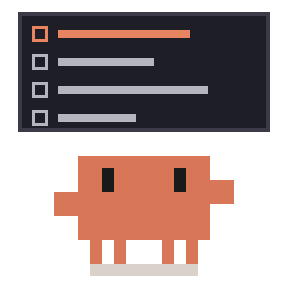 | Watches the todo list as each item turns orange, then gets checked off. When all four are done, confetti falls. |
| 6 | **It's Simple** | 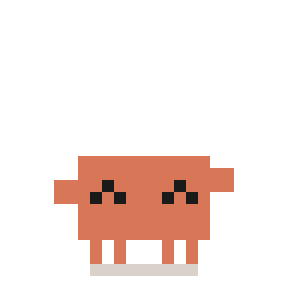 | Pulls on a requirements sheet titled "it's simple" that just keeps unrolling, piling up paper on both sides. |
| 7 | **Subagents** | 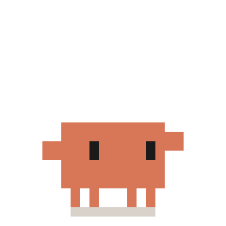 | Sends out three tiny Clawds that run off screen. They come back one by one with check marks, and it cheers. |
| 8 | **Yes, Proceed** | 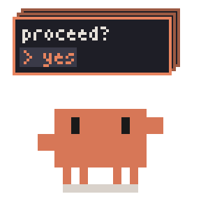 | Permission dialogs keep popping up and it keeps hitting yes, faster and faster, until its eyes go > <. |
| 9 | **LGTM** | 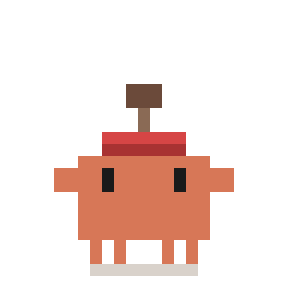 | Raises a rubber stamp and slams down a crooked red LGTM. Means "approved", "got it", or "sounds good". |
| 10 | **You're Absolutely Right!** |  | Nods along eagerly as `You're absolutely right!` appears line by line, with sparkles. |
| 11 | **/compact** |  | A plate labeled `/compact` presses down and flattens it into a pancake. It bounces back happy, then a "?" pops up: what was it doing again? |
| 12 | **/clear** | 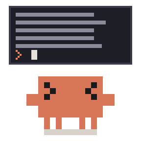 | The terminal is overflowing and its eyes are spinning. Types `/clear`, everything wipes away, and it sparkles with relief. |
| 13 | **Usage Limit** | 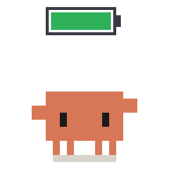 | Types away while a battery drains from green to red. At empty, `limit reached` appears and it melts flat until the battery recharges and it bounces back. |
| 14 | **Esc** | 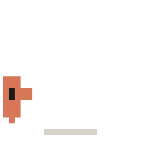 | Charging ahead full speed when a giant Esc key slams down in front of it. It screeches to a stop, nose to the key. |
| 15 | **Banned** | 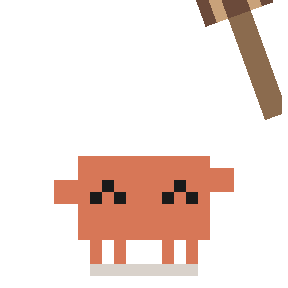 | Typing away happily when a ban hammer swings down. A red BANNED stamp appears, it turns gray, and prison bars drop in front of it. |
| 16 | **git clone** | 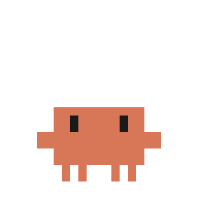 | Types `git clone`, strains and shakes, and splits into three. They take turns hopping, then merge back into one. |
| 17 | **git stash** | 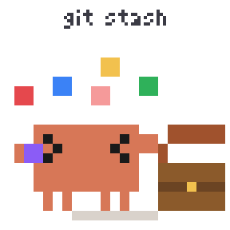 | Panics and shoves every loose change into a treasure chest, slams the lid, then looks away whistling. |
| 18 | **cherry-pick** | 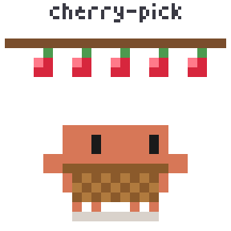 | Hops up and picks exactly two cherries off a branch into its basket, leaving the rest. |
| 19 | **Merge Conflict** | 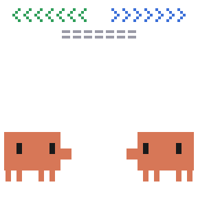 | Under `<<<<<<<` and `>>>>>>>`, two Clawds push head to head with sparks flying, bounce apart, and glare at each other. |
| 20 | **Force Push** | 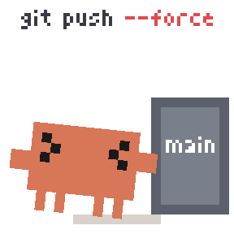 | Shoves a big block labeled `main` until it flies off and cheers. Then the block gets pushed back and squeezes it out. |
| 21 | **git blame** | 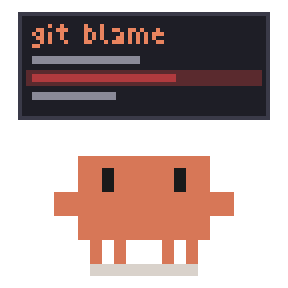 | Furiously points at a broken line under `git blame`, until the author turns out to be itself. Lowers its claw and sidles away, sweating. |
| 22 | **rm -rf** | 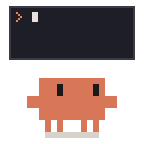 | Types `rm -rf /` and hits Enter. It gets deleted from the feet up until only its eyes are left, then drops back out of the terminal. |
| 23 | **detached HEAD** | 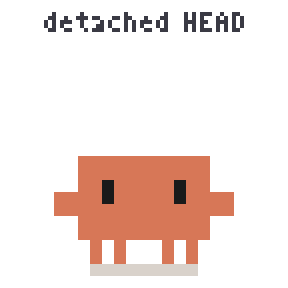 | Its head pops off and floats in place while its body wanders around looking for it, until they click back together. |
| 24 | **404 Not Found** | 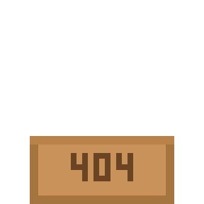 | Peeks out of a box marked 404, looks left and right, realizes it's been spotted, ducks back in, and leaves a "?". |
| 25 | **Error** |  | A red Error flashes overhead. It clutches its head, flips onto its back with legs kicking and stars circling, then flips back up. |
| 26 | **Bug Hunt** | 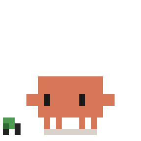 | Tracks a little bug, jumps and sits right on it, feels proud, and then the bug sneaks out the other side. |
| 27 | **Rubber Duck** | 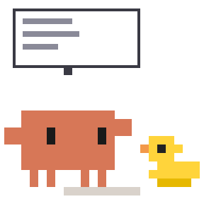 | Explains its code to a rubber duck, waving its claws. A pause... then a light bulb goes on. |
| 28 | **while(true)** | 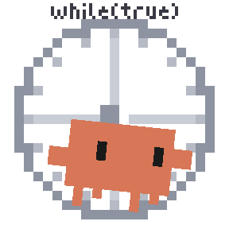 | Runs flat out in a hamster wheel until its eyes go > < and sweat goes flying. |
| 29 | **Stack Overflow** | 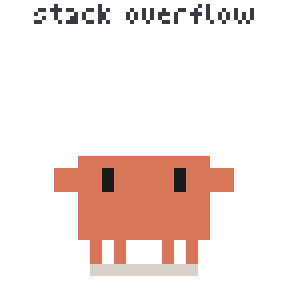 | Plates keep stacking up on its head and wobbling harder, until the whole stack topples and leaves it dazed. |
| 30 | **Memory Leak** | 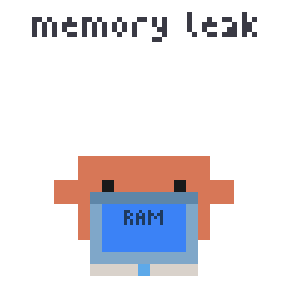 | Holds a jar labeled RAM that springs leak after leak. It flails as the water runs out and the puddle grows. |
| 31 | **Works on My Machine** | 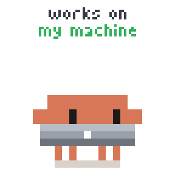 | Hugs its laptop and shrugs, then cuddles it with hearts floating up. |
| 32 | **Tests Passed** | 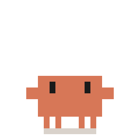 | Watches nervously as a big green check mark draws itself, then hops around in falling confetti. |
| 33 | **Friday Deploy** | 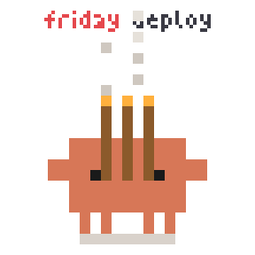 | Under the words `friday deploy`, holds three incense sticks and bows three times with its eyes closed. |
| 34 | **Deadline** | 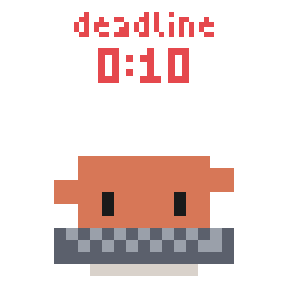 | Types so fast the keyboard catches fire as the red countdown hits zero, then `sent!` appears and it melts flat. |
| 35 | **Overtime** | 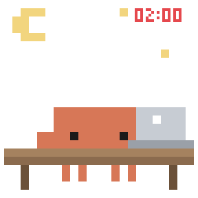 | 02:00 under the moon: nods off at the desk, jolts awake, then slowly drifts off again. |
| 36 | **Coffee Break** | 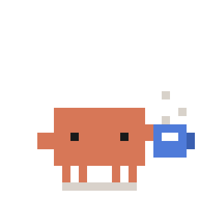 | Sways half asleep, gulps down a blue mug of coffee, and snaps wide awake. |
| 37 | **Slacking Off** | 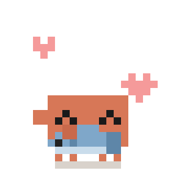 | Holds a little blue fish and gently pets it. The tail wags and small hearts float up. (In Chinese, "slacking off" is literally "petting fish".) |
| 38 | **Clock Out** | 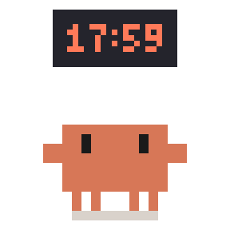 | Stares at the clock until 17:59 turns 18:00, then dashes off screen. Time rewinds to 17:59 and it trudges back. |
| 39 | **Good Night** | 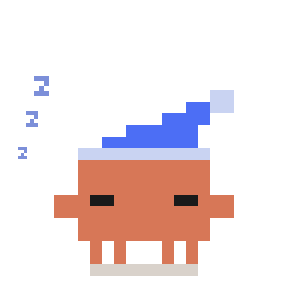 | Sleeps in a blue nightcap while a trail of z's floats up. |
| 40 | **/exit** | 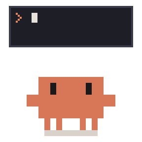 | Types `/exit`, waves goodbye, then shrinks away into the terminal, leaving `bye!` behind. |
